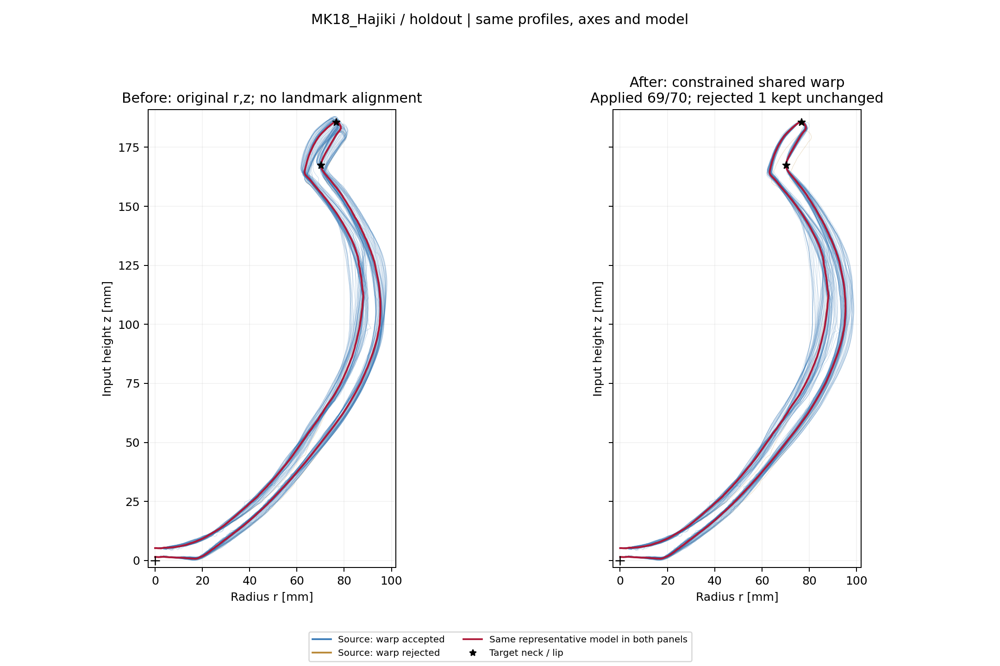
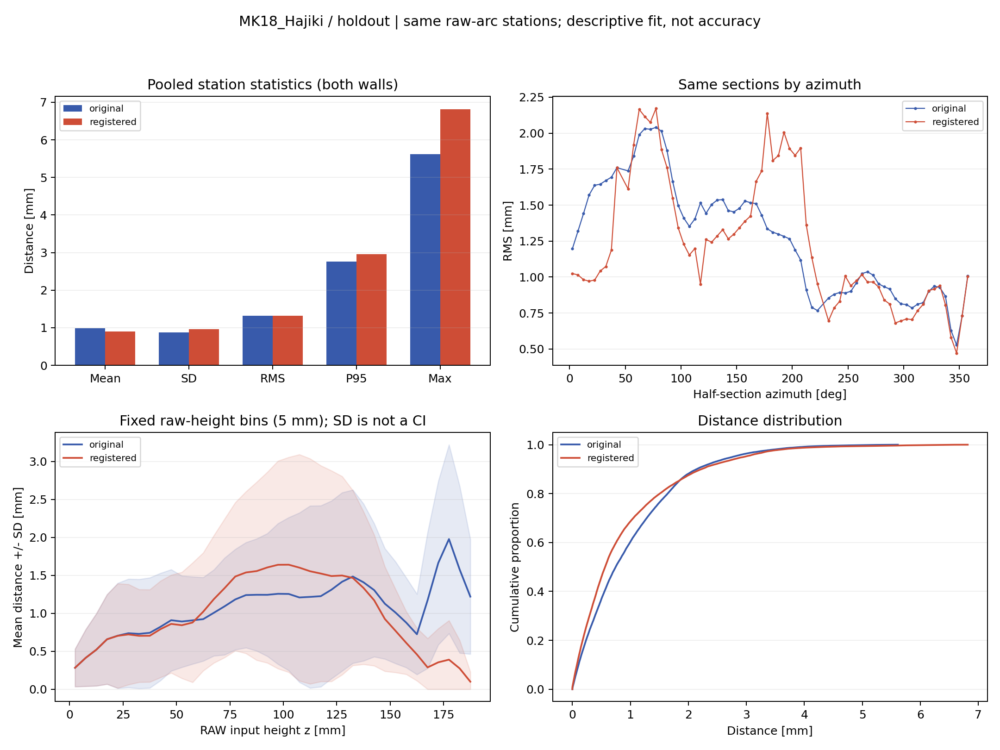
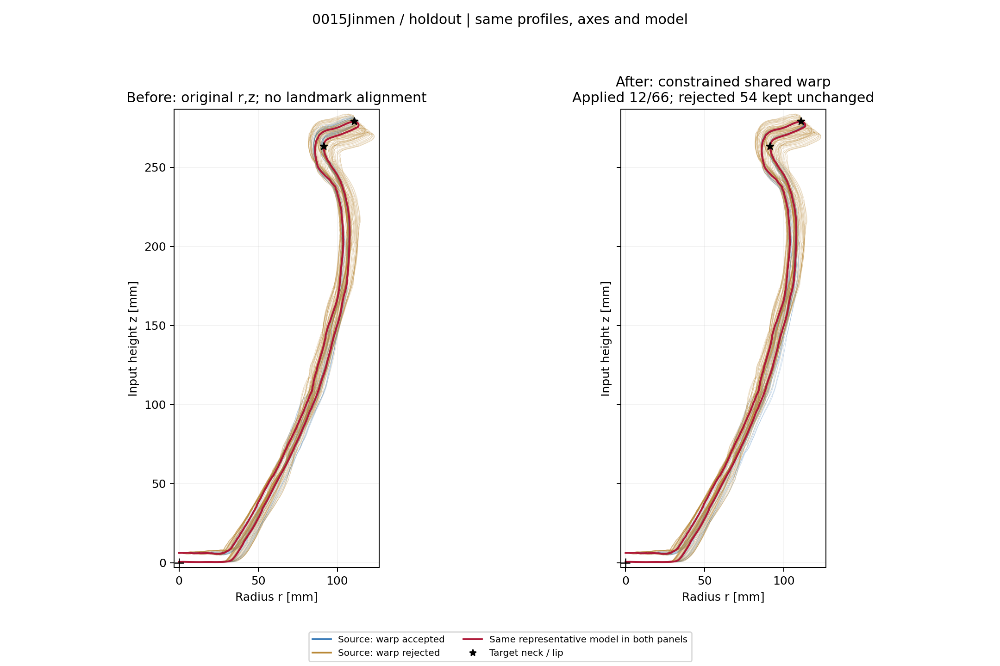
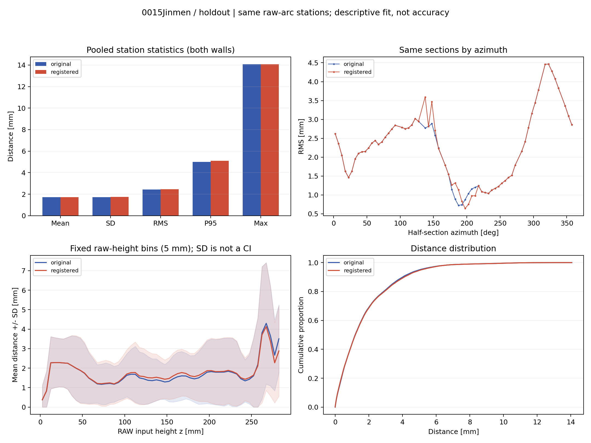

# 全体形状：原位置と特徴点位置合わせ後の比較

0015JinmenとMK18-Hajikiの保存済み探索結果から、説明用の図表を追加しました。モデルや元の検証結果は変更していません。

## 比較条件

左は特徴点変形前の原位置r,z断面、右は頸部・口唇に基づく限定変形後の断面です。共通の半径–高さ平面へ投影し、左右の縮尺、採用断面群、代表モデルを固定しています。底部保護域は固定し、拒否方向は原形状のまま残しています。

統計は同じ原弧長1 mm測点を使用します。距離は内外面それぞれの測点から同じ表面の代表輪郭線分への符号なし最近傍距離です。器厚や3D C2C距離ではありません。高さ区間と部位は原位置から固定し、変形後に再標本化しません。

## 未使用方位の比較結果

| 個体 | 変形適用／採用半断面 | 全体RMS：原位置→位置合わせ後 mm | 頸部〜口唇RMS：原位置→位置合わせ後 mm |
| --- | ---: | ---: | ---: |
| 0015Jinmen | 12／66 | 2.424→2.455 | 4.665→4.588 |
| MK18-Hajiki | 69／70 | 1.324→1.319 | 1.941→0.536 |

MK18では頸部〜口唇の位置合わせの効果が見えますが、全体RMSは大きく変わりません。0015は変形制限による拒否が多く、全体RMSが小さくなる結果ではありません。これをモデル精度の改善や完全な歪み除去とは解釈しません。

## 図と詳細レポート

- [0015Jinmen：部位・内外面別統計CSV](docs/registration_comparison/0015Jinmen/registration_distance_summary.csv)
- [MK18-Hajiki：部位・内外面別統計CSV](docs/registration_comparison/MK18_Hajiki/registration_distance_summary.csv)









このページにはholdoutの全体比較と統計グラフを掲載します。リンク先CSVにはtraining・holdout、内外面・合算、全体・部位別の統計を収録しています。追加CLIの出力一式には、各個体の頸部・口縁拡大と測点・方位・高さ別CSVもあります。グラフは平均・母SD・RMS・p95・最大、方位別RMS、高さ区間別平均±SD、距離累積分布を示します。測点をプールするため長い断面・部位の重みが大きく、SDは信頼区間ではありません。

## 再実行

```bash
python plot_whole_registration_comparison.py /path/to/0015Jinmen /path/to/MK18_Hajiki
```

MorphPotの最新コードを使用します。保存済み出力にexploration.jsonが必要です。生成先は各個体のvalidation/registration_comparison/です。--output-dirで別の出力先を指定できます。

## 確認範囲

底部保護域・変位節点・拒否時の恒等変換と、同じ測点を使った距離計算の解析的チェックを実施しました。2個体4断面群で前後の測点数一致、拒否方向の座標・距離が変わらないことを確認し、出力画像を目視しました。holdoutも同じ入力メッシュを使用し、独立した実物計測ではありません。

## 指標の読み分け

固定した位置合わせ後モデルに対し、元の測点と同じ測点を変形した後の距離を比較しています。モデルを前後で作り直した比較ではありません。原位置は解析軸を基準に共通の半径–高さ平面へ投影した座標であり、元メッシュの3D座標を直接描いているわけではありません。

MK18の全体平均距離は0.989→0.903 mmですが、母SDは0.879→0.961 mm、p95は2.760→2.956 mm、最大は5.614→6.818 mmです。頸部・口唇の一致を高めても全体のすべての指標が改善するわけではありません。0015はholdout 66半断面のうち54方向が変形拒否のため原形状で残ります。拒否方向を除外して良好な結果だけを示していません。

この説明図は、計測・姿勢・器形差のどれが偏差を生んだかを単独で識別するものではありません。個体群の共通プロトコルを決めるには、カテゴリ内の追加個体・別器形・特徴量の再現性を検証します。

## 生成情報

解析・図表生成日：2026-10-10。レポートへの追記日：2026-10-15。コード：[3c44a56](https://github.com/kotdijian/MorphPot/commit/3c44a56bfeffa2e3f59328bc369ade97b1203706)。入力はbase姿勢の2個体で、復元面と実物由来面の分離は行っていません。
